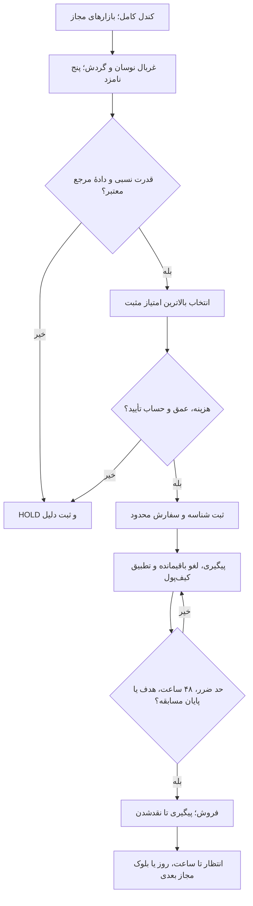

# Starcoach × Wallex — تحقیق و ربات معاملهٔ حساب اعتباری

کدها، داده‌های عمومی، آزمایش‌ها و نتایج ما برای [چالش والکس](https://starcoach.ir/hackathon/agentic-ai/challenges/8). نسخهٔ مبنای فعلی **قانون‌محور و بدون نیاز به AI** است؛ مدل زبانی یک گزینهٔ جداگانه است و نتایج سودده به آن نسبت داده نمی‌شوند.

**وضعیت:** بک‌تست و آزمون‌های محلی انجام شده‌اند. هیچ معاملهٔ واقعی از این پروژه انجام نشده است.
## نصب و آزمون

ربات: Python 3.9+ و کتابخانهٔ استاندارد. پژوهش: NumPy، نسخهٔ بازتولیدشده `2.0.2`.

```sh
git clone https://github.com/nematsymphony-spec/wallex-agentic-trader.git
cd wallex-agentic-trader
python3 -m venv .venv
. .venv/bin/activate
python3 -m pip install -e .
python3 -m pip install -r experiments/requirements.txt
python3 -m unittest discover -s tests -v
PYTHONPATH=src:experiments python3 -m unittest discover -s experiments -p 'test_research30.py' -v
```

پس از نصب، دستور ربات `wallex-credit` است؛ بدون نصب از `PYTHONPATH=src python3 -m wallex_agent.credit_runner` استفاده کنید. دستور قدیمی `wallex-agent` برای نمونهٔ اولیهٔ شبیه‌سازی حفظ شده و مسیر معاملهٔ نسخهٔ فعلی نیست.

## استراتژی و مدیریت سرمایه

### داده و انتخاب فرصت

۱. تمام بازارهای اسپات فعال تومانی، پس از حذف ممنوعیت‌های بستهٔ ۱۸۳ و فهرست ثابت کاربر بررسی می‌شوند؛ روزها UTC با مرز **۰۳:۳۰ تهران** هستند. روز و کندل جاری ناقص حذف می‌شوند.

۲. هفت روز کامل معتبر، حداقل هفت روز سابقه، حداقل ۱۸ ساعت دارای معامله در روز قبل و حد پایین گردش روز قبل حداقل ۵۰ میلیون تومان لازم است. دامنهٔ روزانه `100 × (high / low − 1)` است.

۳. میانگین دامنهٔ هفت‌روزه، سه‌روزه و گردش محلی به رتبهٔ درصدی تبدیل می‌شوند. امتیاز تاریخی: `(0.4 × rank7 + 0.3 × rank3 + 0.1 × rankVolume) / 0.8`. جزء ۲۰٪ هزینه به دلیل نبود دفتر سفارش تاریخی حذف شده؛ این شاخص، جانشین تاریخیِ وزن کامل ۴۰/۳۰/۲۰/۱۰ است. پنج گزینهٔ اول بررسی و تتر/USDC از نامزد خرید حذف می‌شوند.

۴. در آخرین کندل ساعتی کامل، رشد ۲۴ساعته باید مثبت و رشد ۲۴ و ۷۲ساعته از تتر بیشتر باشد. امتیاز قدرت نسبی:

```text
score = (return24_coin − return24_reference) / max(0.001, stdev24_log_returns × sqrt(24))
reference = BTC برای آلت‌کوین؛ USDT برای خود BTC
```

بالاترین امتیاز مثبت انتخاب می‌شود؛ فیلتر جهت کلی BTC نداریم. تابع امتیاز بین پژوهش و ربات مشترک است. نبود دادهٔ معتبر BTC یا تتر، خرید را متوقف می‌کند. کندل مفقود فقط پس از تطبیق حجم کامل روز می‌تواند با حجم صفر تکمیل شود؛ دادهٔ نامعلوم ساخته نمی‌شود.

#### منابع و نسبت آن‌ها با این منطق

منابع زیر چارچوب پژوهشی مومنتوم و قرارداد داده‌های والکس را توضیح می‌دهند. ترکیب غربال نوسان، مقایسه با BTC/USDT و فرمول امتیاز بالا، طراحی همین پروژه است؛ اعتبار تجربی آن با آزمایش‌های ثبت‌شدهٔ مخزن بررسی شده است.

| بخش منطق | مرجع اصلی | کاربرد و محدودهٔ استناد |
|---|---|---|
| مومنتوم و قدرت نسبی در رمزارزها | Liu, Tsyvinski & Wu، *Common Risk Factors in Cryptocurrency*، Journal of Finance، ۲۰۲۲؛ [مقالهٔ منتشرشده](https://doi.org/10.1111/jofi.13119)، [نسخهٔ کاری ۲۰۱۹ در Yale](https://economics.yale.edu/sites/default/files/2022-10/LiuTsyvinskiWu2019%20COMMON%20RISK%20FACTORS.pdf) | پشتوانهٔ عمومی بررسی مومنتوم بین کوین‌ها. نسخهٔ کاری، رتبه‌بندی و مومنتوم یک تا چهار هفته‌ای را بررسی می‌کند؛ نتیجهٔ آن اثبات سوددهی قواعد ساعتی والکس نیست. |
| جهت حرکت گذشتهٔ خود رمزارز | Liu & Tsyvinski، *Risks and Returns of Cryptocurrency*، Review of Financial Studies، ۲۰۲۱؛ [نسخهٔ کاری NBER، ۲۰۱۸](https://www.nber.org/papers/w24877) | شاهد پژوهشی برای بررسی مومنتوم زمانی در رمزارزها؛ پنجره‌های دقیق ۲۴ و ۷۲ ساعت و فیلتر تتر، انتخاب اجرایی پروژه‌اند. |
| مقایسهٔ بازده با مقیاس نوسان | Moskowitz, Ooi & Pedersen، *Time Series Momentum*، Journal of Financial Economics، ۲۰۱۲؛ [متن مقاله، بخش ۲٫۴](https://fairmodel.econ.yale.edu/ec439/mosk.pdf) | مقاله بازده‌ها را با نوسان گذشته مقیاس می‌کند و از اطلاعات پیشین استفاده می‌کند. بازارهای اصلی آن قراردادهای آتی و افق‌های ماهانه‌اند؛ فرمول اختصاصی ما و ضریب `sqrt(24)` در این مقاله برای والکس تأیید نشده‌اند. |
| کندل و ویژگی‌های قیمتی | [مستندات رسمی کندل والکس](https://developers.wallex.ir/docs/basic-services-candles) | قرارداد دادهٔ OHLCV در `/v1/udf/history`؛ میانگین دامنهٔ ۷/۳روزه و حذف کندل ناقص را خود پروژه روی این داده محاسبه می‌کند. |
| فهرست بازار و مجوز بسته | [بازارهای والکس](https://developers.wallex.ir/docs/basic-services-markets)، [جزئیات بستهٔ اعتبار](https://developers.wallex.ir/docs/trade-credit-package-details) | مشخصات بازار در `/v1/markets` و ممنوعیت‌ها در `unavailableMarkets`. اجرای فعلی وضعیت اسپات را با `/hector/web/v1/markets` نیز تطبیق و ممنوعیت‌های کاربر را به آن اضافه می‌کند. |
| امکان ورود و خروج و هزینهٔ فعلی | [دفتر سفارش والکس](https://developers.wallex.ir/docs/basic-services-depth) | دادهٔ `/v1/depth` برای محاسبهٔ هزینه با مصرف هر دو سمت دفتر؛ این برداشت فعلی، هزینهٔ خروج دو روز بعد یا دفتر سفارش تاریخی را مشخص نمی‌کند. |

**پارامترهای انتخابی ما:** اولویت نوسان و وزن‌های ۴۰/۳۰/۲۰/۱۰ از ترجیح ثبت‌شدهٔ کاربر آمده‌اند. نرمال‌سازی تاریخی بر ۰٫۸، پنجره‌ها، پنج نامزد، حداقل هفت روز سابقه، ۱۸ ساعت فعال، گردش ۵۰ میلیون تومان، مرز UTC و کف مخرج `0.001` تصمیم‌های این پروژه‌اند؛ منابع بالا برای این اعداد بهینگی آماری اثبات نمی‌کنند. دامنهٔ `high/low−1` شاخص غربال است و امتیاز نهایی، احتمال سود یا نسبت شارپ اندازه‌گیری‌شده نیست.

برای بررسی پیاده‌سازی و شواهد خود پروژه: [غربال و امتیاز مشترک](src/wallex_agent/monthly_policy.py)، [تعریف غربال تاریخی](experiments/research30.py)، [گزارش تمام خانواده‌های آزموده‌شده](docs/RESEARCH30_ALL_METHODS_FA.md)، [مقایسهٔ ۳۰/۶۰/۹۰روزه](results/research-monthly-goals/comparison.csv) و [آزمون‌های حسابداری و علیت داده](experiments/test_research30.py).

### ورود، نگه‌داری و خروج

- ورود بعد از بسته‌شدن کندل ساعتی، با بررسی مجدد مجوز بازار، عمق هر دو سمت، هزینه، دقت قیمت/مقدار و حداقل سفارش انجام می‌شود. هزینه یا عمق نامناسب به HOLD می‌انجامد؛ انتخاب دوم با اطلاع پسینی از اجرا نشدن انتخاب اول جایگزین نمی‌شود.
- طبق انتخاب کاربر، **تمام سرمایهٔ قابل استفاده** پس از رزرو کارمزد و گردکردن مقدار؛ فقط یک موقعیت هم‌زمان. `allocation=1` است و قابل تنظیم است.
- حد ضرر قیمت هر موقعیت **۵٪**، حداکثر نگه‌داری **۴۸ ساعت**. حد ضرر تضمین سقف زیان حساب نیست؛ شکاف قیمت و هزینه می‌توانند زیان بیشتری ایجاد کنند.
- افت **۲٪ روزانه** نسبت به ارزش ابتدای روز تهران، خرید تازه را تا روز بعد متوقف می‌کند؛ خروج‌ها ادامه دارند. نسخهٔ انتخاب‌شده توقف ۵٪ کل حساب ندارد؛ نسخه‌های دارای توقف کل نیز با نتایجشان حفظ شده‌اند.
- هدف خالص حساب **۳٪ یا ۵٪ در بلوک‌های متوالی ۳۰روزه** است، نه ماه تقویمی؛ پیش‌فرض اجرا ۳٪ است. تا رسیدن به هدف، بعد از خروج امکان ورود تازه وجود دارد؛ پس از رسیدن به هدف، تا بلوک بعد نقد می‌مانیم. موقعیت در مرز بلوک به‌زور بسته نمی‌شود.
- تغییر رتبهٔ نمادها هنگام نگه‌داری موجب تعویض موقعیت نمی‌شود. خروج‌های حفاظتی به پاسخ AI وابسته نیستند.
- پنج دقیقه قبل از `trading_end_at`، خرید متوقف و تلاش برای فروش الگوریتمی و تسویه به تومان آغاز می‌شود. زمان پایان واقعی معاملات باید صریح تنظیم شود؛ مهلت ارسال کد جای آن نیست. دارایی باقیمانده یا کمتر از حداقل سفارش، نقدشدن موفق گزارش نمی‌شود.



## نتایج قابل بازتولید

سرمایهٔ شروع ۵ میلیون تومان. نتایج زیر پس از کارمزد **۰٫۳۰٪ هر سمت** و فاصلهٔ کامل خریدوفروش **۰٫۲۰٪ فرضی** هستند. کارمزد اعتبار در مشاهدهٔ حساب صفر بود. فاصلهٔ فرضی، دفتر سفارش تاریخی اندازه‌گیری‌شده نیست. جدول مربوط به سیاست «بدون توقف افت کل حساب» است.

| دوره | هدف هر ۳۰ روز | بازده خالص | موجودی نهایی، تومان | معاملات بسته | بیشترین افت ساعتی |
|---|---:|---:|---:|---:|---:|
| ۳۰ روز | ۳٪ | +۳٫۲۲۹٪ | ۵٬۱۶۱٬۴۴۴ | ۱ | ۲٫۷۹۵٪ |
| ۳۰ روز | ۵٪ | +۵٫۲۷۶٪ | ۵٬۲۶۳٬۸۱۳ | ۱ | ۲٫۷۹۵٪ |
| ۶۰ روز | ۳٪ | +۶٫۹۳۵٪ | ۵٬۳۴۶٬۷۳۶ | ۲ | ۴٫۳۵۸٪ |
| ۶۰ روز | ۵٪ | +۱۱٫۸۸۱٪ | ۵٬۵۹۴٬۰۵۲ | ۲ | ۴٫۳۵۸٪ |
| ۹۰ روز | ۳٪ | +۱۰٫۱۴۳٪ | ۵٬۵۰۷٬۱۴۶ | ۴ | ۵٫۸۰۲٪ |
| ۹۰ روز | ۵٪ | +۱۷٫۴۷۵٪ | ۵٬۸۷۳٬۷۵۹ | ۴ | ۵٫۸۰۲٪ |

بازهٔ ۹۰روزه: `2026-07-25T00:00:00Z` تا `2026-10-23T00:00:00Z`؛ دوره‌های کوتاه‌تر پایان مشترک دارند. ۵۵ ساعت لازم برای اجرای معامله با دادهٔ دقیقه‌ای و تطبیق حجم بازبینی شدند. بازپخش جدید **۳۶ اجرا**، شامل ۱۸ سناریو و دو ترتیب درون‌کندلی را با همان بازده، افت، کارمزد و تعداد معاملات بازتولید کرد؛ خطای کمتر از `1e-7`.

این نتیجه از معاملات کم و انتخاب استراتژی پس از پژوهش حاصل شده؛ آزمون مستقل آینده یا اثبات سود مستمر نیست. محدودیت بقا در جهان بازارهای فعلی، نبود دفتر سفارش تاریخی، صف، تأخیر و لغزش واقعی برقرار است. تفاوت اجرای واقعی با شبیه‌سازی به معنای یکسان بودن بازده نیست.

### مقایسه با خرید و نگه‌داری BTC و PUMP

هر مرجع مستقل با همان **۵ میلیون تومان**، همان شروع و پایان دوره، کارمزد **۰٫۳۰٪ هر سمت**، فاصلهٔ کامل **۰٫۲۰٪ فرضی**، رزرو کارمزد و دقت مقدار بازار محاسبه شده است: یک خرید با تمام سرمایهٔ قابل استفاده در شروع نخستین ساعت و یک فروش در قیمت بسته‌شدن آخرین کندل کامل دوره. در مرجع، توقف سود یا خروج با حد ضرر اتفاق نیفتاده و دارایی در تمام دوره نگه داشته شده است. سود تقسیمی، درآمد نگه‌داری، اهرم و تزریق سرمایه فرض نشده‌اند. BTC و PUMP همان دو مرجع از پیش تعیین‌شدهٔ پژوهش‌اند.

در جدول، «اختلاف» برابر **بازده ما منهای بازده مرجع، بر حسب واحد درصد** است؛ عدد منفی یعنی بازده کمتر از خرید و نگه‌داری. نسخهٔ ما همان سیاست هدفِ تجدیدشوندهٔ ۳۰روزه و بدون توقف افت کل جدول قبلی است.

| دوره | هدف هر ۳۰ روز | بازده خالص ما | خرید و نگه‌داری BTC | اختلاف ما با BTC | خرید و نگه‌داری PUMP | اختلاف ما با PUMP |
|---|---:|---:|---:|---:|---:|---:|
| ۳۰ روز | ۳٪ | +3.229٪ | +13.116٪ | −9.887 | +21.433٪ | −18.204 |
| ۳۰ روز | ۵٪ | +5.276٪ | +13.116٪ | −7.840 | +21.433٪ | −16.157 |
| ۶۰ روز | ۳٪ | +6.935٪ | +43.731٪ | −36.796 | +16.049٪ | −9.114 |
| ۶۰ روز | ۵٪ | +11.881٪ | +43.731٪ | −31.850 | +16.049٪ | −4.168 |
| ۹۰ روز | ۳٪ | +10.143٪ | +78.586٪ | −68.443 | +249.466٪ | −239.323 |
| ۹۰ روز | ۵٪ | +17.475٪ | +78.586٪ | −61.111 | +249.466٪ | −231.990 |

برای مقایسهٔ ریسک، بیشترین افت حساب با نمونه‌برداری یکسانِ **بسته‌شدن کندل‌های ساعتی و پس از هزینهٔ فرضی نقدکردن**:

| دوره | افت ما، هدف ۳٪ | افت ما، هدف ۵٪ | افت خرید و نگه‌داری BTC | افت خرید و نگه‌داری PUMP |
|---|---:|---:|---:|---:|
| ۳۰ روز | 2.795٪ | 2.795٪ | 10.150٪ | 44.364٪ |
| ۶۰ روز | 4.358٪ | 4.358٪ | 10.150٪ | 44.364٪ |
| ۹۰ روز | 5.802٪ | 5.802٪ | 10.150٪ | 44.364٪ |

**نتیجهٔ این نمونه:** هر دو نسخهٔ ما در هر سه بازه از هر دو مرجع بازده کمتری داشته‌اند؛ بیشترین افت ساعتی آن‌ها نیز کمتر بوده است. استراتژی ما پس از رسیدن به هدف نقد می‌ماند و سقف نگه‌داری هر موقعیت ۴۸ ساعت دارد؛ مرجع‌ها به‌طور پیوسته ۳۰، ۶۰ یا ۹۰ روز در بازارند. بنابراین این مقایسه، ریسک و زمان حضور در بازار را هم‌سطح نکرده و برتری تعدیل‌شده با ریسک را اثبات نمی‌کند. افت ساعتی نیز شدیدترین زیان درون ساعت را نشان نمی‌دهد. نبود دفتر سفارش تاریخی و هزینهٔ اجرای واقعی برای هر دو طرف برقرار است.

[جدول عددی شامل بازده، افت، کارمزد و موجودی نهایی](results/research-monthly-goals/buy-hold-comparison.csv) و [گزارش تطبیق و اثرانگشت منابع](results/research-monthly-goals/buy-hold-comparison.json) از فایل‌های منجمد ساخته می‌شوند. بازده، کارمزد، موجودی و افت هر شش مرجع مستقلاً از قیمت‌های ساعتی دوباره محاسبه و با نتایج قبلی تطبیق داده شدند؛ جست‌وجوی پارامتر تازه انجام نشد. بازسازی گزارش مقایسه، بدون شبکه و بدون تغییر استراتژی:

```sh
python3 experiments/compare_buy_hold.py
```

### اجرای مجدد پژوهش

دادهٔ عمومی منجمد در `data/` موجود است. از ریشهٔ مخزن:

```sh
PYTHONPATH=src:experiments python3 experiments/research_monthly_goals.py
```

این دستور جست‌وجوی پارامتر تازه انجام نمی‌دهد؛ اگر داده‌های دقیقه‌ای لازم حذف شوند، برای تکمیل آن‌ها از API عمومی استفاده می‌کند.

- [جدول همهٔ سیاست‌ها](results/research-monthly-goals/comparison.csv)، [معاملات با دلیل خروج](results/research-monthly-goals/trades.csv)، [بلوک‌های سود](results/research-monthly-goals/blocks.csv).
- [نتایج کامل](results/research-monthly-goals/results.json)، [تأیید بازپخش جدید](results/credit-validation/policy-parity.json)، [شرح فارسی نتایج](docs/MONTHLY_GOALS_FA.md).
- [فهرست تمام پژوهش‌های موفق و ناموفق](docs/RESEARCH_INDEX_FA.md)، [مشاهدهٔ کارمزد حساب](docs/VERIFIED_ACCOUNT_FEES.md).

## تست سایه

```sh
wallex-credit paper --config config/credit-research.json --db results/private/my-paper.db --cycles 12
wallex-credit status --db results/private/my-paper.db
wallex-credit export --db results/private/my-paper.db
```

`paper` به کلید والکس نیاز ندارد و هیچ درخواست خصوصی یا سفارش واقعی ارسال نمی‌کند. سیاست و برنامه‌ریزی سفارش با مسیر واقعی مشترک‌اند؛ پرشدن با قیمت محدود محافظه‌کارانه فرض می‌شود و صف/تأخیر واقعی ارزیابی نمی‌شود.

در آزمون جدید، ۶۲ بازار مجاز دیده شد و ۴۰ بازار از غربال عبور کردند؛ دادهٔ مرجع USDTTMN ناقص بود و خرید انجام نشد. برای هر پروفایل سه چرخه ثبت شد؛ چرخه‌های بعدی منتظر ساعت بعد ماندند. این آزمون کوتاه حفاظت داده است، نه تست سوددهی. تست قدیمی AI هم به علت نبود کلید OpenAI به HOLD رسیده بود. [گزارش سایه و آزمون‌ها](results/credit-validation/validation.json).

## کلید API و اجرای واقعی

بر اساس [مستندات اسپات والکس](https://developers.wallex.ir/docs/spot-intro)، **کلید اختصاصی حساب اعتباری و هدر `sub-account-client-id` هر دو** لازم‌اند. از کلید حساب اصلی استفاده نکنید. برنامه قابلیت برداشت، انتقال یا اتصال کیف‌پول اصلی ندارد.

```sh
# دریافت محرمانه در ترمینال محلی؛ کلید را در چت یا آرگومان دستور وارد نکنید
wallex-credit setup --secrets .secrets/credit.json

# فقط خواندن: بررسی حساب prop، بسته ۱۸۳، انقضا، موجودی، سفارش باز و نرخ کارمزد
wallex-credit doctor --config config/credit-research.json --secrets .secrets/credit.json
```

در `config/credit-research.json`، `trading_end_at` را با **زمان واقعی پایان معاملات** در قالب ISO8601 دارای منطقهٔ زمانی تنظیم کنید؛ ساختار: `YYYY-MM-DDTHH:MM:SS+03:30`. نرخ Maker/Taker واقعی نماد از `/v1/account/fee` خوانده می‌شود؛ نرخ بالاتر از ذخیرهٔ محافظه‌کارانهٔ تنظیم‌شده مانع خرید است.

```sh
# پس از بازبینی تنظیمات: اثرانگشت سورس و تنظیمات همان نسخهٔ تحویلی
wallex-credit freeze

# این دستور قابلیت ثبت سفارش واقعی دارد و باید پیوسته روشن بماند
wallex-credit run --config config/credit-research.json --secrets .secrets/credit.json \
  --db results/private/credit-live.db --cycles 0
```

حساب باید prop فعال و غیرمعلق، از بستهٔ ۱۸۳، با اتصال کیف‌پول اصلی غیرفعال باشد. دارایی یا سفارش مدیریت‌نشده، تغییر غیرمنتظرهٔ کیف‌پول یا پاسخ ناشناخته مانع اجراست؛ fallback به حساب اصلی وجود ندارد. **این مسیر با کلید واقعی هنوز آزموده نشده است.**

شناسه پیش از POST در SQLite ثبت می‌شود. در قطع ارتباط، POST تکرار نمی‌شود؛ همان شناسه استعلام می‌شود. سفارش باز بعد از ۲۰ ثانیه درخواست لغو می‌گیرد و نهایی‌شدن باید تأیید شود. پس از نهایی‌شدن، موجودی واقعی کیف‌پول مبناست. خروج ناقص تا حد عمق مجاز پیگیری می‌شود. فقط **یک پردازش و یک فایل وضعیت برای هر حساب** اجرا کنید؛ فایل وضعیت زنده را حذف یا جایگزین نکنید. [راهنمای عملیات](docs/CREDIT_RUNBOOK_FA.md).

## معماری و لاگ تصمیم‌ها

| جزء | پیاده‌سازی |
|---|---|
| بازار، کندل، عمق و ممنوعیت‌ها | `src/wallex_agent/clients.py` |
| غربال و قدرت نسبی مشترک با پژوهش | `src/wallex_agent/monthly_policy.py` |
| اتصال فقط به حساب اعتباری و چرخهٔ سفارش | `src/wallex_agent/credit_api.py` |
| سیاست، کنترل ریسک، وضعیت پایدار و اجرای سایه/واقعی | `src/wallex_agent/credit_runner.py` |
| لاگ SQLite با زنجیرهٔ هش | `src/wallex_agent/engine.py: AuditLog` |
| تمام خانواده‌های استراتژی و ارزیابی‌ها | `experiments/` و `results/` |

هر سفارش به ورودی بازار، دلیل ورود/خروج، کنترل هزینه، عمق، شناسه و نتیجهٔ اجرا وصل است. در اجرای زنده، خروجی لاگ معاملات پس از حذف اطلاعات حساب باید به تحویل داور افزوده شود؛ اکنون هیچ لاگ معاملهٔ واقعی وجود ندارد. کلیدها و فایل‌های خصوصی منتشر نمی‌شوند.

`credit-research.json` مبنای فعلی و بدون AI است. `credit-competition-ai.json` پروفایل اختیاریِ حق رد ورود توسط OpenAI است؛ پاسخ نامعتبر یا نبود کلید به HOLD می‌انجامد. نتایج جدول مربوط به این پروفایل نیستند. طبق تصمیم فعلی تیم، معیار امتیاز «نقش واقعی AI» هدف‌گذاری نشده؛ صرف وجود ماژول، اثبات کسب آن امتیاز نیست.

## ضوابط و وضعیت تحویل

[پروندهٔ تحویل](docs/SUBMISSION_FA.md) معماری، قواعد، لاگ و سناریوی دموی حدود پنج دقیقه را توضیح می‌دهد. مرور صفحهٔ مسابقه مهلت **۱ آبان ۱۴۰۵ ساعت ۲۳:۵۰ تهران** و ارسال یک‌بارهٔ لینک GitHub و ویدئوی عمومی را نشان داد. ویدئو الزامی است و هنوز تولید/منتشر نشده؛ این مخزن به‌تنهایی تحویل کامل مسابقه نیست. فرم مسابقه ارسال نشده است.

`release/manifest.json` اثرانگشت سورس و تنظیمات است؛ تغییر آن‌ها تا freeze مجدد مانع شروع اجرای واقعی می‌شود. سورس در حال معامله باید همان نسخهٔ تحویلی باقی بماند. تنها حساب اختصاصی و معاملات الگوریتمیِ بازارهای مجاز استفاده می‌شوند؛ در پایان باید سود/زیان به تومان محقق شود. میزان سرمایه‌گذاری کامل انتخاب کاربر است و با توصیهٔ امتیازی مدیریت سرمایهٔ مسابقه یکسان نیست.
